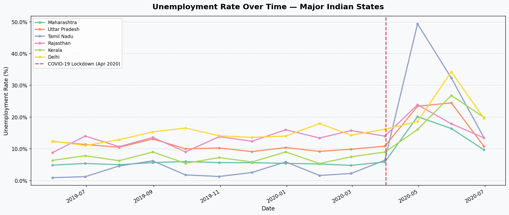

# 📊 Unemployment in India — COVID-19 Economic Impact Analysis

<p align="center">
  
</p>

> **Uncovering India's jobs crisis through data: a month-by-month story of economic resilience, regional disparity, and pandemic shock.**

---

## 🎯 Objective

This project is a comprehensive **Exploratory Data Analysis (EDA)** of unemployment trends across India's 28 states and Union Territories, with a sharp analytical focus on the **economic impact of the COVID-19 pandemic (April–June 2020)**. It was developed as **Task 2** of the [Oasis Infobyte Data Science Internship](https://oasisinfobyte.com/).

The analysis answers three core questions:
1. Which Indian states have the **highest structural unemployment** (pre-pandemic)?
2. How did the **COVID-19 lockdown (April 2020)** reshape India's employment landscape?
3. What is the statistical relationship between unemployment, employment count, and labour force participation?

---

## 📂 Project Structure

```
DataScience-Task2-UnemploymentAnalysisWithPython/
│
├── 📓 unemployment_analysis.ipynb    # Main Jupyter Notebook (fully annotated)
├── 📄 Unemployment_in_India.csv      # Raw dataset (Kaggle source)
├── 📋 requirements.txt               # Python dependency list with pinned versions
├── 📖 README.md                      # This file
│
├── .venv/                            # Python virtual environment (not committed)
│
└── visuals/                          # Auto-generated PNG charts
    ├── timeseries_line_chart.png     # Unemployment over time — 6 major states
    ├── top10_states_bar_chart.png    # Top 10 high-unemployment states
    ├── correlation_heatmap.png       # Correlation matrix heatmap
    └── covid_impact_comparison.png   # Pre vs Post-COVID comparison
```

---

## 🛠️ Tech Stack

| Tool | Version | Purpose |
|---|---|---|
| **Python** | 3.11.5 | Core language |
| **pandas** | 2.2.3 | Data loading, cleaning, manipulation, and aggregation |
| **numpy** | 1.26.4 | Numerical computations and array operations |
| **matplotlib** | 3.9.4 | Base charting engine for all visualizations |
| **seaborn** | 0.13.2 | Statistical heatmap and advanced styling |
| **Jupyter** | 1.1.1 | Interactive notebook environment |
| **nbformat** | 5.10.4 | Notebook format compliance |

---

## 📦 Data Source

**Dataset:** [Unemployment in India — Kaggle](https://www.kaggle.com/datasets/gokulrajkmv/unemployment-in-india)

- **Provider:** Centre for Monitoring Indian Economy (CMIE)
- **Coverage:** All major Indian states and UTs, monthly frequency
- **Date Range:** May 2019 – June 2020
- **Records:** 768 raw rows → **740 clean records** after preprocessing
- **Known Data Quirk:** Column names contain leading whitespace (e.g., `' Date'`, `' Estimated Unemployment Rate (%)'`) — handled programmatically in the cleaning pipeline.

---

## 🔄 Detailed Workflow

### Phase 1 — Environment Setup
1. Scanned workspace to identify CSV filename.
2. Created `requirements.txt` with pinned library versions for reproducibility.
3. Created a Python 3.11.5 virtual environment (`.venv`) and installed all dependencies.

### Phase 2 — Data Cleaning Pipeline
| Step | Action |
|---|---|
| Column whitespace stripping | `df.columns.str.strip()` removes invisible leading spaces |
| String value normalisation | All object columns trimmed of surrounding whitespace |
| Column renaming | Long column names shortened for code readability |
| Date parsing | `pd.to_datetime(dayfirst=True)` to handle DD-MM-YYYY format |
| Null removal | Dropped 28 fully-empty trailing rows and rows missing key fields |

### Phase 3 — Analyses Performed
| # | Analysis | Method |
|---|---|---|
| 1 | Region-wise average unemployment rate | `groupby + mean` |
| 2 | Time-series line chart for 6 major states | Matplotlib multi-line plot with COVID reference |
| 3 | Top 10 states by average unemployment | Bar chart with value labels |
| 4 | Correlation heatmap | Seaborn `heatmap` on 3-column correlation matrix |
| 5 | Pre-COVID vs Post-COVID comparison | Date-split + mean + grouped bar + horizontal bar charts |

### Phase 4 — Deliverables
- Production-quality Jupyter Notebook with Markdown narrative and insight cells after every chart
- All 4 visualizations exported as 150 DPI PNG files in `visuals/`
- This README

---

## 🔑 Key Findings & Insights

### 1. 🦠 COVID-19 Caused a 110% Unemployment Surge

| Period | Mean Rate | Change |
|---|---|---|
| Pre-COVID (May 2019 – Mar 2020) | **9.61%** | Baseline |
| Post-COVID (Apr – Jun 2020) | **20.19%** | **+10.58 pp / +110%** |

India's unemployment **more than doubled in 3 months** — an economic disruption with no modern precedent. The COVID-19 lockdown was an equal-opportunity disruptor, triggering simultaneous spikes in every state regardless of its economic profile.

### 2. 🗺️ Regional Inequality is Extreme — A 5.9× Gap

- **Tripura (28.35%)** and **Haryana (26.28%)** lead by a wide margin due to structural economic weaknesses.
- **Meghalaya (4.80%)** and **Odisha (5.66%)** show the lowest averages, partly reflecting agrarian/informal employment that continues through crises.
- The gap between best and worst is nearly **6×**, confirming unemployment is fundamentally a regional — not purely a national — phenomenon.

### 3. 🏭 Industrialised States Suffered the Sharpest COVID Spikes

| State | Pre-COVID | Post-COVID | % Change |
|---|---|---|---|
| Puducherry | 1.58% | 57.70% | **+3,549%** |
| Tamil Nadu | 3.16% | 31.74% | **+904%** |
| Karnataka | 3.27% | 19.16% | **+485%** |

Manufacturing and service-dependent states (Tamil Nadu, Karnataka, Maharashtra) experienced catastrophic spikes when factories and offices shut. Rural-agrarian states fared relatively better since food production was essential and continued.

### 4. 📉 Weak Correlations Reveal India's Informal Economy

- **Unemployment ↔ Labour Participation: r = +0.003** (near-zero)
- In Western economies this correlation is strongly negative (job losses → workers exit labour force). In India, workers shift to subsistence/informal work rather than dropping out — a critical structural difference.
- **Unemployment ↔ Employed Count: r = –0.223** (moderate negative as expected)

### 5. 📈 April 2020 is a Clear Structural Break

The time-series line chart shows that April 2020 is a **simultaneous, synchronised inflection point** across all 6 major states — a textbook example of an exogenous economic shock creating a uniform response in an otherwise highly heterogeneous labour market.

---

## 🚀 Setup & Running the Notebook

### Prerequisites
- Python 3.8+ installed ([python.org](https://python.org))
- `git` (optional, for cloning)

### Step-by-Step Setup

```bash
# 1. Clone or download this repository
git clone https://github.com/YOUR_USERNAME/DataScience-Task2-UnemploymentAnalysisWithPython.git
cd DataScience-Task2-UnemploymentAnalysisWithPython

# 2. Create a Python virtual environment
python -m venv .venv

# 3. Activate the virtual environment
# On Windows (PowerShell):
.venv\Scripts\Activate.ps1
# On macOS / Linux:
source .venv/bin/activate

# 4. Install all dependencies
pip install -r requirements.txt

# 5. Launch Jupyter Notebook
jupyter notebook unemployment_analysis.ipynb
```

### Running All Cells
Once the notebook opens in your browser:
- Click **Kernel → Restart & Run All** to execute all cells top-to-bottom.
- Charts will be rendered inline **and** saved to the `visuals/` directory.
- No internet connection is required — all data is local.

### Expected Output
- 29 notebook cells execute without errors
- 4 PNG charts generated in `visuals/`
- Console outputs include descriptive statistics and COVID comparison tables

---

## 📊 Sample Visualizations

| Chart | Preview |
|---|---|
| Time-Series Line Chart | `visuals/timeseries_line_chart.png` |
| Top 10 States Bar Chart | `visuals/top10_states_bar_chart.png` |
| Correlation Heatmap | `visuals/correlation_heatmap.png` |
| COVID Impact Comparison | `visuals/covid_impact_comparison.png` |

---

## 🧑‍💻 Author

**Asif Ahmad**
Data Science Intern — Oasis Infobyte
*Task 2: Unemployment Analysis with Python*

---

## 📜 License

This project is submitted as part of an internship task. The dataset is sourced from Kaggle under its respective license. Code and analysis are original work.

---

<p align="center">
  <i>Built with ❤️ using Python, pandas, matplotlib, and seaborn</i>
</p>
