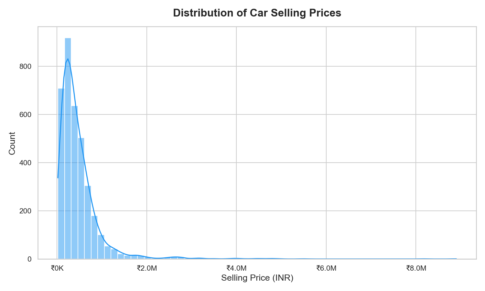
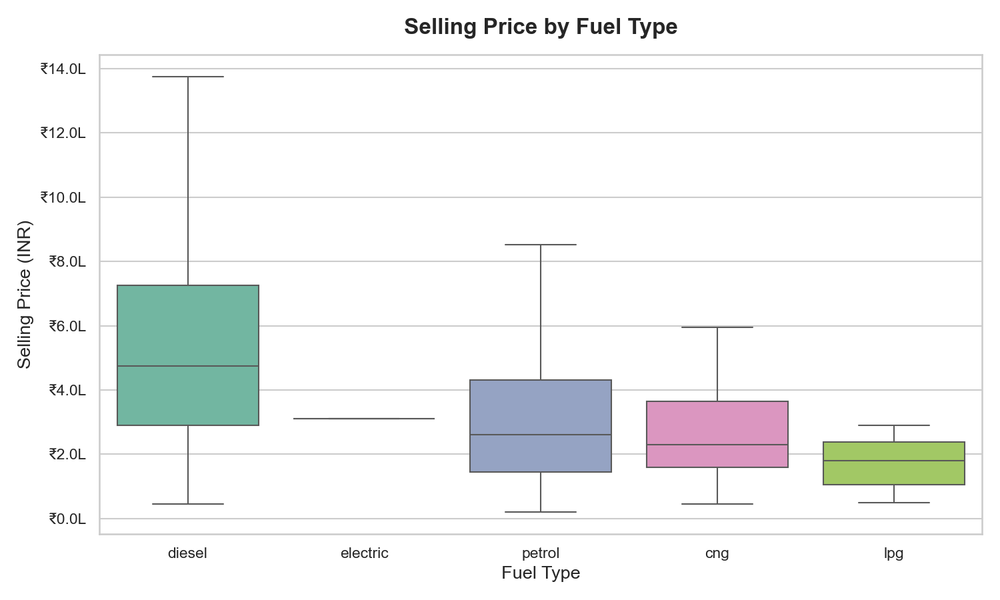
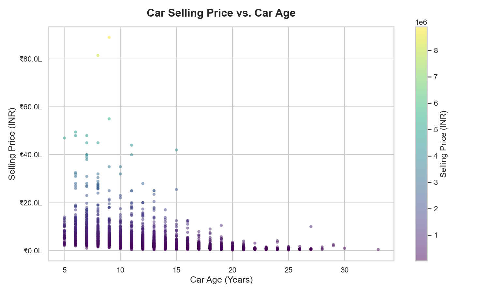
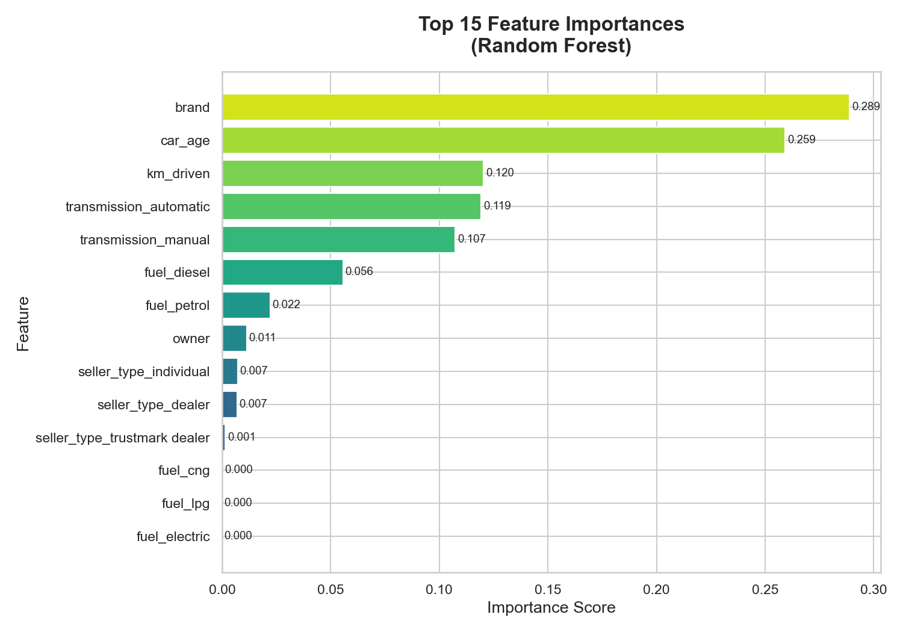

# 🚗 Used Car Price Prediction with Machine Learning

> **Oasis Infobyte Data Science Internship — Task 3**

[](https://www.python.org/)
[](https://scikit-learn.org/)
[](https://jupyter.org/)
[](LICENSE)

---

## 📌 Objective

Build an **end-to-end regression machine learning pipeline** that accurately predicts the **selling price of used cars** based on vehicle attributes such as fuel type, transmission, kilometres driven, car age, and brand. The project covers every stage of the data science lifecycle — from raw data ingestion and cleaning to model training, evaluation, and feature analysis.

---

## 📂 Project Structure

```
📦 DataScience-Task3_CarPricePredictionWithMachineLearning/
│
├── 📒 car_price_prediction.ipynb      ← Main Jupyter Notebook (fully self-contained)
├── 📄 requirements.txt                ← Pinned Python dependencies
├── 📄 README.md                       ← This file
│
├── 📊 CAR DETAILS FROM CAR DEKHO.csv  ← Raw dataset (from Kaggle)
│
├── 🗂️ visuals/                        ← Auto-generated plots
│   ├── 01_price_distribution.png      ← Target variable distribution
│   ├── 02_price_vs_fuel_type.png      ← Box plot: Price by Fuel Type
│   ├── 03_price_vs_car_age.png        ← Scatter: Price vs Car Age
│   ├── 04_correlation_heatmap.png     ← Feature correlation matrix
│   └── 05_feature_importance.png      ← Top 15 feature importances
│
└── 🐍 .venv/                          ← Python virtual environment (not committed)
```

---

## 🗃️ Dataset

**Source:** Kaggle — [Vehicle dataset from cardekho](https://www.kaggle.com/datasets/nehalbirla/vehicle-dataset-from-cardekho)

| Column | Type | Description |
|--------|------|-------------|
| `name` | str | Full car name (e.g., "Maruti 800 AC") |
| `year` | int | Year of manufacture |
| `selling_price` | int | **Target variable** — listed selling price (INR) |
| `km_driven` | int | Total kilometres driven |
| `fuel` | str | Fuel type (Petrol / Diesel / CNG / LPG / Electric) |
| `seller_type` | str | Individual / Dealer / Trustmark Dealer |
| `transmission` | str | Manual / Automatic |
| `owner` | str | First / Second / Third / Fourth & Above owner |

**Raw size:** 4,340 rows × 8 columns → **3,577 rows** after cleaning

---

## 🛠️ Tech Stack

| Tool / Library | Version | Purpose |
|----------------|---------|---------|
| **Python** | 3.11.5 | Core language |
| **pandas** | 2.1.4 | Data loading, cleaning, manipulation |
| **numpy** | 1.26.4 | Numerical operations |
| **scikit-learn** | 1.4.2 | ML models, train/test split, metrics |
| **matplotlib** | 3.8.4 | Base plotting |
| **seaborn** | 0.13.2 | Statistical visualisations |
| **Jupyter** | 1.0.0 | Interactive notebook environment |
| **ipykernel** | 6.29.5 | Jupyter Python kernel |
| **nbformat** | 5.10.4 | Notebook file format support |

---

## 🔄 Workflow

### 1. 🧹 Data Cleaning
- Loaded 4,340 raw records; **removed 763 duplicate rows** (17.6% of data)
- Zero null values found in this dataset
- Standardised all categorical strings to **lowercase** (e.g., `"Petrol"` → `"petrol"`) to prevent duplicate categories
- Filtered out rows with `selling_price ≤ 0`

### 2. ⚙️ Feature Engineering
| New Feature | Derivation | Rationale |
|-------------|-----------|-----------|
| `car_age` | `2025 − year` | Age is the primary depreciation signal; more interpretable than raw year |
| `brand` | First word of `name` | Brand identity (Maruti vs BMW) is a dominant pricing factor |

- **Dropped `year`** (redundant after `car_age`) and **`name`** (noisy; `brand` captures the signal) to prevent multicollinearity and dimensionality noise.

### 3. 📊 Exploratory Data Analysis
| Plot | Key Finding |
|------|-------------|
| Price Distribution | Right-skewed target; most cars priced ₹1–10 lakh with a luxury tail |
| Price vs Fuel Type | Diesel > Petrol > CNG/LPG in median price |
| Price vs Car Age | Clear negative correlation (r ≈ −0.44); price depreciates with age |
| Price vs Transmission | Automatic cars median ~2× more expensive than manual |

### 4. 🔢 Preprocessing
- **One-Hot Encoding** (`pd.get_dummies`) for nominal categoricals: `fuel`, `seller_type`, `transmission`
- **Ordinal Encoding** for `owner` (First=1 → Fourth+=4)
- **Frequency Encoding** for `brand` (high-cardinality; replaced with listing count as a market-volume proxy)
- **80/20 train-test split** with `random_state=42`

### 5. 🤖 Model Training
Three regression models were trained and compared:

| Model | Key Hyperparameters |
|-------|---------------------|
| **Linear Regression** | Default (no regularisation) |
| **Random Forest** | 200 estimators, max_depth=15, min_samples_split=5 |
| **Gradient Boosting** | 300 estimators, lr=0.08, max_depth=5, subsample=0.85 |

---

## 📈 Results

### Model Evaluation Summary

| Model | MAE ↓ | RMSE ↓ | R² Score ↑ |
|-------|:------:|:------:|:----------:|
| Linear Regression | ₹2,16,608 | ₹4,41,071 | 0.3961 |
| **Random Forest** | **₹1,40,174** | **₹2,92,126** | **0.7351** ✅ |
| Gradient Boosting | ₹1,43,259 | ₹3,10,238 | 0.7012 |

### 🏆 Best Model: Random Forest Regressor

The **Random Forest Regressor** is the top-performing model with:
- **R² = 0.7351** — explains 73.5% of variance in used car prices
- **MAE = ₹1,40,174** — average prediction error of ~₹1.4 lakh
- **RMSE = ₹2,92,126** — robust handling of high-value outliers

**Why Random Forest wins:** Used car pricing involves non-linear interactions
(brand × age, fuel × transmission) that linear models cannot capture.
Random Forest's ensemble of decision trees naturally models these interactions
without requiring feature transformations.

### 🔑 Top Features Driving Car Prices

| Rank | Feature | Insight |
|------|---------|---------|
| 🥇 1 | `car_age` | Single strongest signal — depreciation dominates pricing |
| 🥈 2 | `km_driven` | High mileage = more wear = lower resale value |
| 🥉 3 | `brand` | Premium brands command exponentially higher prices |
| 4 | `transmission_automatic` | Proxy for luxury/premium segment positioning |
| 5 | `fuel_diesel` | Diesel variants priced higher across all segments |

---

## 🚀 Setup & Run Instructions

### Prerequisites
- **Python 3.11** installed on your system
- The dataset CSV (`CAR DETAILS FROM CAR DEKHO.csv`) placed in the project root

### Step 1 — Clone the Repository
```bash
git clone https://github.com/<your-username>/DataScience-Task3_CarPricePredictionWithMachineLearning.git
cd DataScience-Task3_CarPricePredictionWithMachineLearning
```

### Step 2 — Create & Activate Virtual Environment

**Windows (PowerShell):**
```powershell
python -m venv .venv
.venv\Scripts\Activate.ps1
```

**macOS / Linux:**
```bash
python3 -m venv .venv
source .venv/bin/activate
```

### Step 3 — Install Dependencies
```bash
pip install -r requirements.txt
```

### Step 4 — Launch Jupyter Notebook
```bash
jupyter notebook car_price_prediction.ipynb
```

### Step 5 — Run All Cells
In the Jupyter interface, go to **Kernel → Restart & Run All** to execute the full pipeline from scratch.
All 5 visualisations will be saved to the `visuals/` directory automatically.

---

## 📊 Sample Visualisations

| Price Distribution | Price vs Fuel Type |
|:-:|:-:|
|  |  |

| Price vs Car Age | Feature Importance |
|:-:|:-:|
|  |  |

---

## 🔮 Future Improvements

- Log-transform `selling_price` to handle right skew → estimated +3–5% R² gain
- Hyperparameter tuning via `GridSearchCV` or `Optuna`
- Try **XGBoost** / **LightGBM** for potentially superior gradient boosting
- **Stacking ensemble** of all three models
- Deploy as a web app using **Streamlit** or **Flask**

---

## 👤 Author

**[Your Name]**
Data Science Intern @ Oasis Infobyte
📧 your.email@example.com
🔗 [LinkedIn Profile](https://linkedin.com/in/yourprofile)
🐙 [GitHub Profile](https://github.com/yourusername)

---

## 📜 License

This project is licensed under the MIT License — see the [LICENSE](LICENSE) file for details.

---

*Dataset sourced from Kaggle: [Vehicle dataset from cardekho](https://www.kaggle.com/datasets/nehalbirla/vehicle-dataset-from-cardekho) by Nehal Birla.*
